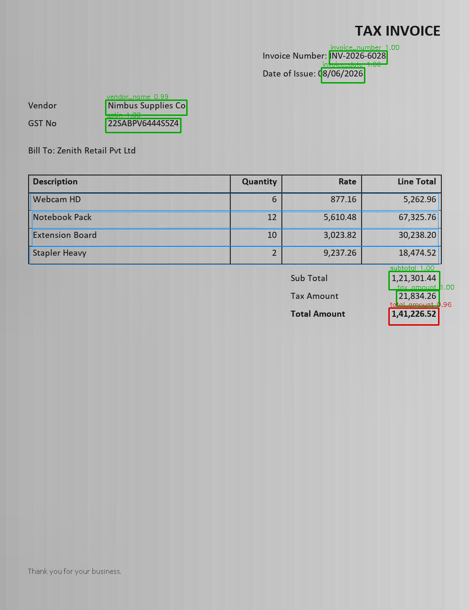

# DocuSight AI — Layout-Aware Document Intelligence

**Tech stack:** Python · PyTorch · Hugging Face Transformers · OpenCV · PaddleOCR · scikit-learn · FastAPI · Docker

An end-to-end document AI pipeline for lending workflows. It takes a scanned or photographed
**bank statement, invoice, payslip or PAN-style KYC card** and returns the document type, typed key
fields, table rows and a review decision. Every value carries the bounding box of the region it was read
from. A field that is missing, inconsistent or low-confidence sends the document to human review.

```
image/PDF ─► OpenCV preprocessing ─► PaddleOCR ─► layout analysis ─► classifier (HF BERT / TF-IDF)
              perspective · deskew      tokens +     lines → segments      │
              denoise · deblur · CLAHE  boxes + conf  reading order        ▼
              binarise · morphology                              schema for doc type
                                                                         │
            ┌────────────────────────────────────────────────────────────┤
            ▼                                                            ▼
   key-value extraction                                     table recognition
   label → same-segment / right / below                     ruled grid (morphology) or
   + position-aware OCR correction                          header-anchored columns
            └──────────────────────► validation ◄────────────────────────┘
                     required · format · confidence · arithmetic consistency
                                      │
                            ExtractionResult (+ bbox per value) ─► FastAPI / review queue / metrics
```

## Results (held-out set)

Measured on **220 held-out documents** (55 per type). The test set's names, companies and items never
appear in training. Every document went through real PaddleOCR on CPU, after synthetic scan/photo degradation.

| Metric | Value |
|---|---|
| Document classification macro-F1 (fine-tuned BERT, on OCR text) | **1.000** (TF-IDF baseline: 1.000) |
| Field-level accuracy (1,320 fields, exact match after normalisation) | **97.4%** |
| Field-value CER / page-level OCR CER | **0.021 / 0.010** |
| Table cell accuracy: payslip / bank statement / invoice | 100% / 92.2% / 92.9% |
| Injected anomalies (tampered totals, missing fields, minor DOB) flagged | **26 / 26 (100%)** |
| Problem-document recall / flag precision | 85.7% / 90.6% |
| Straight-through rate (no human review) | 75.9% |
| Auto-approved documents that are fully correct | 95.2% |
| Accuracy of values with confidence ≥ 0.95 vs < 0.80 | 99.4% vs 22.2% (the confidence signal is informative) |
| End-to-end latency p50 / p95 (CPU, OCR ≈ 98% of it) | 7.3 s / 13.5 s |

Honest reading of these numbers:
* Classifying four very different document types is easy. Every model, including the keyword prior,
  reaches F1 = 1.0 here. The classifier earns its place on noisier and larger label sets, not this one.
* Most residual errors are OCR errors: a dropped single digit in a borderless table, a clipped last character
  where text touches a cell rule, or "Emp ID:" misread as "D:". Validation is designed to catch these,
  and does in most cases. The remaining silent errors are mostly one-character slips in free-text narrations.



The full report is in [`reports/eval_report.md`](reports/eval_report.md), with raw numbers in
`reports/eval_report.json`.

## What each part does

| Bullet | Where |
|---|---|
| **OCR + image preprocessing.** Perspective correction for phone photos (page-quad detection + warp), projection-profile deskew, quality-gated denoising (non-local means), unsharp-mask deblurring, CLAHE contrast, adaptive threshold + morphology, ROI cropping | [`preprocessing.py`](docusight/preprocessing.py) |
| **OCR engines.** PaddleOCR PP-OCRv5 (primary), Tesseract (fallback), optional TrOCR (Hugging Face) re-read of low-confidence field crops | [`ocr.py`](docusight/ocr.py) |
| **Document classification over 4 categories.** BERT fine-tuned in PyTorch (`google/bert_uncased_L-2_H-128_A-2`) on OCR-noise-augmented text, compared against a scikit-learn TF-IDF + LogisticRegression baseline and a keyword prior | [`classifier.py`](docusight/classifier.py), [`scripts/train_classifier.py`](scripts/train_classifier.py) |
| **Layout-aware key-value extraction.** Tokens → lines → segments (gap analysis). Fuzzy label matching with rival-label disambiguation (e.g. *Opening* vs *Closing Balance*). The value is read from the same segment, the right neighbour or the cell below. Position-aware OCR correction for PAN/IFSC/GSTIN (`O↔0`, `B↔8`, …) | [`layout.py`](docusight/layout.py), [`extractor.py`](docusight/extractor.py), [`normalize.py`](docusight/normalize.py) |
| **Table recognition.** Ruled tables: horizontal/vertical rule detection with morphology gives column boundaries. Borderless tables: header-anchored column spans. Wrapped multi-line narrations are merged into their row | [`tables.py`](docusight/tables.py) |
| **Evaluation on 200+ held-out samples.** Classification macro-F1 and confusion matrix, field-level accuracy, field- and page-level CER, table row/cell accuracy, breakdowns by degradation and layout, confidence calibration, latency | [`scripts/evaluate.py`](scripts/evaluate.py), [`metrics.py`](docusight/metrics.py) |
| **Confidence-based validation + source-region tracking.** Checks for missing required fields, ID format (regex), low confidence and future dates. Cross-field arithmetic: opening + credits − debits = closing, running balance, qty × rate, Σ line items = subtotal, gross − deductions = net, KYC age ≥ 18. Each issue carries the bbox of its source region | [`validation.py`](docusight/validation.py), [`scripts/visualize.py`](scripts/visualize.py) |
| **Serving.** FastAPI (`/v1/documents/extract`, `/classify`, `/extract-batch`, `/review-queue`), Prometheus `/metrics` (per-stage latency histograms, review-flag and issue counters), PII-masked JSON logs, Docker image with baked-in OCR weights | [`api.py`](docusight/api.py), [`observability.py`](docusight/observability.py), [`Dockerfile`](Dockerfile) |

## Data

No public dataset covers Indian lending documents with field-level labels, so
[`synth.py`](docusight/synth.py) generates them:

* 4 document types × 3 layout variants. Label wording, key-value style (`Label: value` / value to the right / value below),
  ruled vs borderless tables, 3 date formats, Indian digit grouping (`12,34,567.00`) and 7 font families all vary.
* Scan and photo degradation: perspective warp on a background, rotation, uneven lighting, Gaussian noise, blur
  and JPEG compression, at a random severity per document.
* About 12% of documents carry **injected anomalies** (tampered totals or balances, missing GSTIN/IFSC/PAN,
  minor DOB), so review routing is measured against known ground truth.
* **Leakage prevention.** Train and test draw names, companies and line items from *disjoint vocabularies*,
  and use different seeds. `scripts/generate_data.py` audits the splits (no shared entities, no duplicate pages)
  and fails if leakage is found. The classifier's validation split is made *per document before
  augmentation*, so noisy copies of a page never straddle the boundary.

## Quick start

```bash
python -m venv .venv && .venv/Scripts/activate      # Linux/macOS: source .venv/bin/activate
pip install -r requirements.txt

python scripts/generate_data.py --train-per-type 150 --test-per-type 55   # 600 train / 220 test
python scripts/train_classifier.py                                        # TF-IDF baseline + BERT fine-tune
python scripts/evaluate.py --data data/test                               # writes reports/eval_report.{md,json}
python scripts/visualize.py data/test/images/test_invoice_0001.jpg --out reports/overlay.png  # source-region overlay
pytest -q                                                                  # unit + API tests (no OCR models needed)
```

Serve:

```bash
uvicorn docusight.api:app --port 8000
curl -F "file=@data/test/images/test_invoice_0001.jpg;type=image/jpeg" localhost:8000/v1/documents/extract
```

Docker:

```bash
docker build -t docusight-ai . && docker run -p 8000:8000 docusight-ai
```

Configuration is through `DOCUSIGHT_*` environment variables (see [`config.py`](docusight/config.py)), e.g.
`DOCUSIGHT_OCR_ENGINE=tesseract`, `DOCUSIGHT_TROCR_REFINE=1`, `DOCUSIGHT_FIELD_CONF_THRESHOLD=0.85`.

### Sample response (trimmed, `reports/sample_invoice_0001.json`)

This test invoice has a tampered grand total. The issue points back to the exact pixels it came from:

```json
{
  "doc_type": "invoice", "doc_type_confidence": 0.8248,
  "fields": {
    "total_amount": {"value": "141226.52", "raw_text": "1,41,226.52", "confidence": 0.9583,
                     "bbox": [831, 658, 933, 690], "method": "right"}
  },
  "tables": [{"strategy": "header_anchored", "columns": ["item", "qty", "unit_price", "amount"], "rows": ["..."]}],
  "issues": [{"code": "INCONSISTENT", "field": "total_amount", "severity": "error",
              "message": "subtotal + tax != total", "bbox": [831, 658, 933, 690]}],
  "needs_review": true, "review_reasons": ["INCONSISTENT"],
  "preprocessing": ["clahe", "adaptive_threshold+morph_open"],
  "timings_ms": {"preprocess": 73.2, "ocr": 7760.9, "layout": 0.5, "classify": 61.4, "extract": 12.1, "validate": 0.4, "total": 7908.5}
}
```

## Engineering notes

* **Windows DLL clash.** PaddlePaddle and PyTorch ship conflicting DLLs, so torch must load first
  (`docusight/__init__.py`). Paddle 3.3's oneDNN CPU kernels fail on some PIR attributes, so MKL-DNN is
  off by default (`DOCUSIGHT_PADDLE_MKLDNN=1` turns it back on).
* **Phrase-level vs word-level OCR.** PaddleOCR returns phrases, so each detection is kept as one segment.
  Tesseract returns words, which are merged into segments by horizontal gap analysis.
* **Thread safety.** The Paddle predictor is not thread-safe. The API serialises inference behind a lock
  and scales out with processes or replicas rather than threads.
* **PII.** Results are held in memory only, and logs mask IDs, names and DOB (last 4 characters kept).

## Limitations / next steps

* The data is synthetic. The pipeline is template-agnostic (no coordinates are hard-coded), but real scans
  will show a lower ceiling. The next step is labelling real documents in Label Studio and fine-tuning a
  layout model such as LayoutLMv3 for token classification.
* OCR dominates latency on CPU. GPU inference, batching detection across pages, or exporting the PP-OCR
  models to ONNX Runtime/TensorRT would be the first optimisations.
* Only the first page of a PDF is processed.
