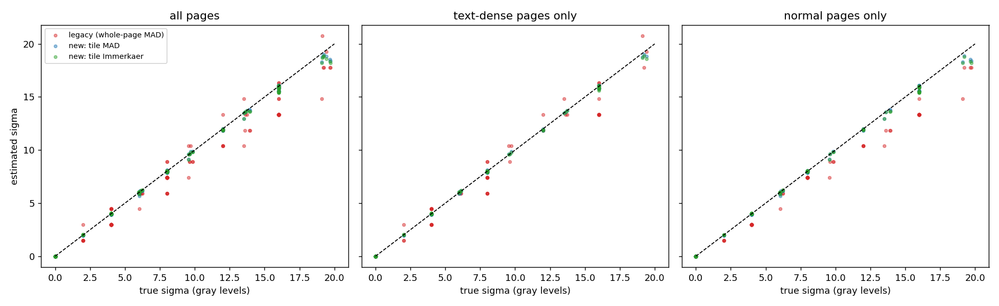
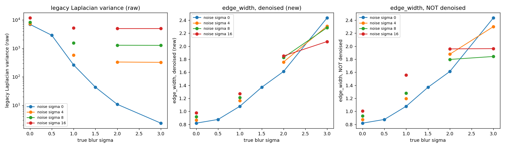
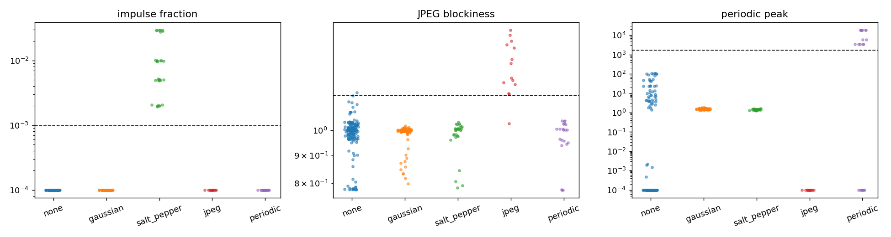
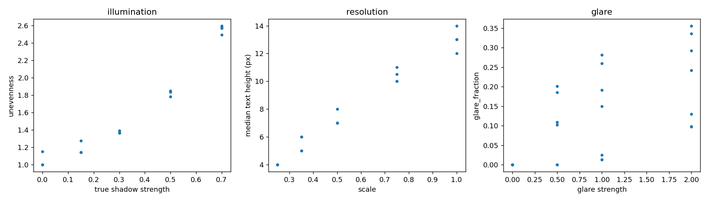

# Image-quality estimators: validation against ground truth

_Generated by `scripts/validate_quality.py`. Evaluation set: 385 images = 7 base pages x 55 recipes with known parameters (`data/quality_calib`; 3 of the pages are text-dense). Hint thresholds were fitted on a separate tuning set (165 images, different seed/pages) and are only *reported* on the evaluation set._

## Revision history (read this first)

The estimators were run on the evaluation set once in their first form (kept verbatim in [`quality_validation_v1_initial.md`](quality_validation_v1_initial.md)). That run exposed real defects, which were debugged using the separate **tuning set only**, and the evaluation numbers below are from the revised estimators. Because the evaluation set had already been looked at, treat it as a development-grade check, not a blind test; the blind test is the OCR/CER experiment on `data/test` (Stage 6). What the first run showed and what changed:

| First run (v1) on the evaluation set | Cause | Change |
|---|---|---|
| Noise-type hints 81.0% accurate; 18 clean/shadow/glare/low-res pages flagged salt-and-pepper | flat tiles were chosen on a median-filtered image, which also erases 1-px strokes and table rules, so those tiles looked like paper with 'impulses' | flatness now ignores isolated impulses only (isolated-pixel rule) instead of median-filtering; per-tile adaptive thresholds |
| JPEG recall 0% (24/28 missed) | blockiness was measured on flat paper only; a perfectly flat region has no blocking even after JPEG; ruled pages gave 'blocky' scores without any JPEG | measured on content with long rules masked, second-difference form; class redefined to q <= 30 with q 50-75 reported as a grey zone |
| Periodic peak threshold fitted to 5e12 | median spectral power ~0 on noise-free paper makes max/median explode | added the 8-bit quantisation-noise floor and plane detrending |
| Dense low-resolution pages: mean sigma 4.29, 42% false alarms | blurred dense text passed the gradient test and was treated as paper | block-mean structure test; such pages now return *not measurable* |
| `sigma = 2` images split between 'gaussian' and 'none' | visibility cut-off equal to the smallest injected level | cut-off 1.5 (a design choice, not fitted) |
| Report text claimed glare 0.5 is not saturated | wrong - measured glare_fraction was 0.085 | corrected |

## A. Noise sigma estimation

Ground truth: the injected Gaussian sigma (Poisson recipes: the equivalent std on paper, sqrt(255*L/peak)). Subset = images whose only noise is additive Gaussian/Poisson (plus the clean and blur-only images, true sigma 0). Columns: Pearson / Spearman correlation of estimate vs truth, mean absolute error (gray levels), mean bias, and the OLS slope (1.0 = unbiased).

| Estimator - subset | n | Pearson | Spearman | MAE | bias | slope |
|---|---|---|---|---|---|---|
| legacy (whole-page MAD) - all pages | 175 | 0.989 | 0.992 | 0.92 | -0.79 | 0.89 |
| new: tile MAD - all pages | 175 | 1.000 | 0.996 | 0.10 | -0.08 | 0.98 |
| new: tile Immerkaer - all pages | 175 | 1.000 | 0.993 | 0.10 | -0.08 | 0.98 |
| legacy (whole-page MAD) - text-dense pages only | 75 | 0.985 | 0.988 | 0.80 | -0.48 | 0.93 |
| new: tile MAD - text-dense pages only | 75 | 1.000 | 0.996 | 0.07 | -0.04 | 0.99 |
| new: tile Immerkaer - text-dense pages only | 75 | 1.000 | 0.993 | 0.06 | -0.05 | 0.99 |
| legacy (whole-page MAD) - normal pages only | 100 | 0.995 | 0.999 | 1.01 | -1.01 | 0.86 |
| new: tile MAD - normal pages only | 100 | 1.000 | 0.996 | 0.12 | -0.11 | 0.98 |
| new: tile Immerkaer - normal pages only | 100 | 0.999 | 0.993 | 0.12 | -0.11 | 0.97 |

### Failure modes: images whose true Gaussian sigma is 0

Mean estimated sigma (and false-alarm rate = share of images with estimate > 2) per defect class. Ideal = 0.

| Defect | Pages | n | legacy mean est. | new mean est. | legacy false alarm | new false alarm |
|---|---|---|---|---|---|---|
| clean | normal | 4 | 0.00 | 0.00 | 0% | 0% |
| clean | dense | 3 | 0.00 | 0.00 | 0% | 0% |
| gaussian blur | normal | 20 | 0.00 | 0.00 | 0% | 0% |
| gaussian blur | dense | 15 | 0.00 | 0.00 | 0% | 0% |
| motion blur | normal | 16 | 0.00 | 0.00 | 0% | 0% |
| motion blur | dense | 12 | 0.00 | 0.00 | 0% | 0% |
| salt & pepper | normal | 16 | 0.00 | 0.00 | 0% | 0% |
| salt & pepper | dense | 12 | 0.00 | 0.00 | 0% | 0% |
| JPEG q<=50 | normal | 12 | 0.00 | 0.00 | 0% | 0% |
| JPEG q<=50 | dense | 9 | 1.32 | 0.00 | 33% | 0% |
| JPEG q>=75 | normal | 8 | 0.00 | 0.00 | 0% | 0% |
| JPEG q>=75 | dense | 6 | 0.49 | 0.00 | 17% | 0% |
| shadow | normal | 16 | 0.00 | 0.00 | 0% | 0% |
| shadow | dense | 12 | 0.00 | 0.00 | 0% | 0% |
| low resolution | normal | 16 | 0.00 | 0.00 | 0% | 0% |
| low resolution | dense | 12 | 0.00 | 0.00 | 0% | 0% |
| periodic | normal | 12 | 0.00 | 0.00 | 0% | 0% |
| periodic | dense | 9 | 0.00 | 0.00 | 0% | 0% |

Salt-and-pepper (true Gaussian sigma = 0): density vs estimates - the impulse fraction should track density.

| density | legacy sigma | new sigma | impulse fraction |
|---|---|---|---|
| 0.002 | 0.00 | 0.00 | 0.0020 |
| 0.005 | 0.00 | 0.00 | 0.0050 |
| 0.01 | 0.00 | 0.00 | 0.0099 |
| 0.03 | 0.00 | 0.00 | 0.0288 |

Dense text pages: flat-tile fraction used = 0.15 (normal pages 0.73); images reported as *not measurable* (too few paper tiles): 7% of all dense images (12/165: lowres0.25, lowres0.35, lowres0.5, lowres0.75, periodic8) and 2% of normal ones.

## B. Blur

Ground truth: injected Gaussian blur sigma. Direction: *higher legacy Laplacian variance = sharper*, *higher edge_width = blurrier*; Spearman is signed so that +1 always means 'perfectly monotone in the right direction'. New scores are computed on the image **after denoising** (NLM, as the pipeline does whenever sigma > 2).

No added noise; 6 blur levels (0, 0.5, 1, 1.5, 2, 3) per base page (a tie between blur 0 and 0.5 counts as not strictly monotone; edge_width has an intrinsic floor of ~0.8 px from anti-aliasing):

| Score | mean Spearman (right direction = +1) | pages strictly monotone over all 6 levels |
|---|---|---|
| legacy Laplacian variance (raw) | 1.000 | 7/7 |
| edge_width (denoised) | 0.998 | 6/7 |
| tenengrad_norm (denoised) | 1.000 | 7/7 |
| lap_var_edge (denoised) | 1.000 | 7/7 |
| edge_width (NOT denoised) | 0.998 | 6/7 |

**Content dependence.** Coefficient of variation (std/mean) of each score *across the 7 different pages* at the same true blur. A good sharpness measure should vary with blur, not with what is printed on the page:

| Score | blur 0.0 | blur 0.5 | blur 1.0 | blur 1.5 | blur 2.0 | blur 3.0 |
|---|---|---|---|---|---|---|
| legacy Laplacian variance (raw) | 0.91 | 0.87 | 0.76 | 0.66 | 0.59 | 0.69 |
| edge_width (denoised) | 0.03 | 0.06 | 0.10 | 0.10 | 0.13 | 0.01 |
| tenengrad_norm (denoised) | 0.14 | 0.13 | 0.12 | 0.08 | 0.08 | 0.09 |
| lap_var_edge (denoised) | 0.24 | 0.22 | 0.16 | 0.27 | 0.35 | 0.48 |
| edge_width (NOT denoised) | 0.03 | 0.06 | 0.10 | 0.10 | 0.13 | 0.01 |

**Noise inflation.** Score at noise sigma 16 divided by the same page & blur with no noise (1.00x = noise does not move the score; for the legacy sharpness score a value >1 means noise makes a blurry page look *sharper*):

| True blur | legacy Laplacian var (raw) | edge_width (denoised) | edge_width (NOT denoised) | tenengrad_norm (denoised) |
|---|---|---|---|---|
| blur 1.0 | 39.74x | 1.18x | 1.46x | 0.78x |
| blur 2.0 | 686.70x | 1.16x | 1.23x | 0.99x |
| blur 3.0 | 3732.60x | 0.85x | 0.81x | 1.32x |

Motion blur (length 3/5/9/15 px at a random angle, plus clean): Spearman(length, edge_width) = 0.801. Edge width is isotropic (it uses the gradient magnitude), so it detects motion blur but cannot tell its direction.

## C. Noise-type hints

Rule: periodic peak -> *periodic*; else impulse fraction -> *salt_pepper*; else JPEG blockiness -> *jpeg*; else sigma > 1.5 -> *gaussian*; else *none*. Thresholds below were fitted (max one-vs-rest F1) on the **tuning set** and are reported on the evaluation set.

| Hint | fitted threshold |
|---|---|
| periodic_peak | 1731 |
| impulse_fraction | 0.0009777 |
| jpeg_blockiness | 1.159 |

**Evaluation set** - rows: true class, columns: predicted:

| true \ pred | none | gaussian | salt_pepper | jpeg | periodic | recall |
|---|---|---|---|---|---|---|
| none | 174 | 0 | 0 | 1 | 0 | 99% |
| gaussian | 0 | 133 | 0 | 0 | 0 | 100% |
| salt_pepper | 0 | 0 | 28 | 0 | 0 | 100% |
| jpeg | 1 | 0 | 0 | 13 | 0 | 93% |
| periodic | 7 | 0 | 0 | 0 | 14 | 67% |

Overall accuracy 97.6% (n=371).

Misclassified (true -> predicted: recipes; `*` = dense page):

* jpeg -> none: jpeg30* (1 images)
* none -> jpeg: lowres0.25 (1 images)
* periodic -> none: periodic8, periodic8* (7 images)

**(for reference) tuning set - thresholds were fitted here** - rows: true class, columns: predicted:

| true \ pred | none | gaussian | salt_pepper | jpeg | periodic | recall |
|---|---|---|---|---|---|---|
| none | 75 | 0 | 0 | 0 | 0 | 100% |
| gaussian | 0 | 57 | 0 | 0 | 0 | 100% |
| salt_pepper | 0 | 0 | 12 | 0 | 0 | 100% |
| jpeg | 0 | 0 | 0 | 6 | 0 | 100% |
| periodic | 2 | 0 | 0 | 0 | 7 | 78% |

Overall accuracy 98.7% (n=159).

**JPEG grey zone and blockiness by quality** (mean over pages; threshold above; q 50-75 are excluded from the confusion table because the grid evidence is smaller than page-to-page variation):

| JPEG quality | mean blockiness (normal pages) | mean blockiness (dense pages) | detected as jpeg (all pages) |
|---|---|---|---|
| 95 | 0.996 | 0.928 | 0% |
| 75 | 1.027 | 0.952 | 0% |
| 50 | 1.102 | 1.029 | 0% |
| 30 | 1.215 | 1.140 | 86% |
| 15 | 1.436 | 1.417 | 100% |
Clean pages: mean blockiness 0.970 (min 0.779, max 1.035).

## D. Exposure and resolution estimators

* **Illumination unevenness** vs true shadow strength (0, 0.15, 0.3, 0.5, 0.7; 20 normal pages): Spearman 0.964; mean unevenness by strength: 0.0: 1.04, 0.15: 1.18, 0.3: 1.37, 0.5: 1.83, 0.7: 2.56.
  Expected for a linear ramp 1 -> (1-s): 1/(1-s) = 0.0: 1.00, 0.15: 1.18, 0.3: 1.43, 0.5: 2.00, 0.7: 3.33 (the estimator's percentile range shrinks this).
* On the *dense* pages unevenness for strength 0.7 = 2.59 vs 2.56 on normal pages; clean dense = 1.00 (text covers the paper so the background map is less reliable).
* **Glare** (a Gaussian hot spot, strength 0.5/1.0/2.0): strength 0: glare_fraction 0.0000, text-edge ratio inside the blob vs a ring around it nan; strength 0.5: glare_fraction 0.0854, text-edge ratio inside the blob vs a ring around it 0.31; strength 1.0: glare_fraction 0.1332, text-edge ratio inside the blob vs a ring around it 0.16; strength 2.0: glare_fraction 0.2216, text-edge ratio inside the blob vs a ring around it 0.11. All three strengths saturate the centre of this paper level (about 220 + 0.5*255 > 250), and the share of edges inside the blob falls as strength rises (text is progressively wiped out).
* **Text height** vs rendering scale (1, 0.75, 0.5, 0.35, 0.25; 20 normal pages): linear fit text_height = 12.0 x scale +1.2, R^2 = 0.977. Median text height by scale: 1.0: 13.0px, 0.75: 10.2px, 0.5: 7.0px, 0.35: 5.5px, 0.25: 4.0px.

