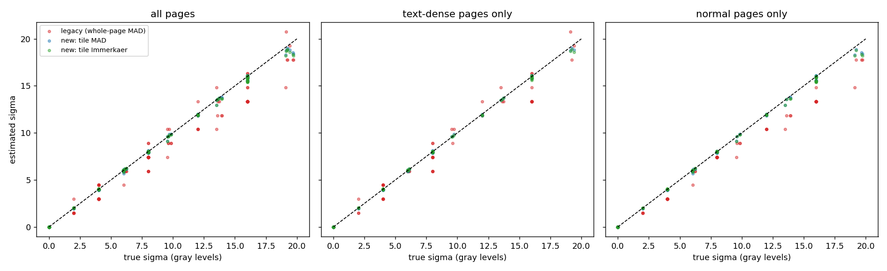
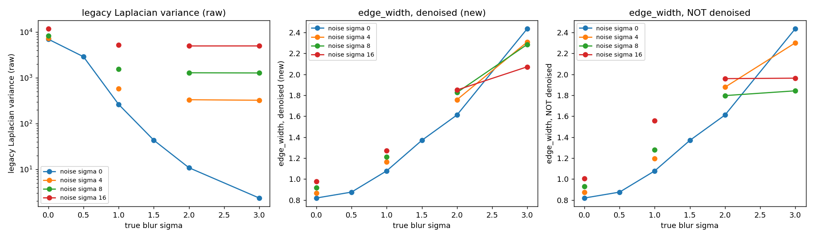
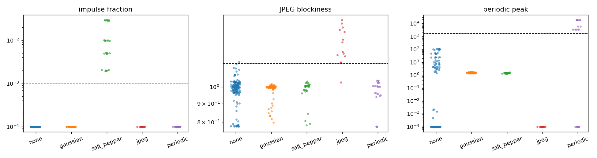
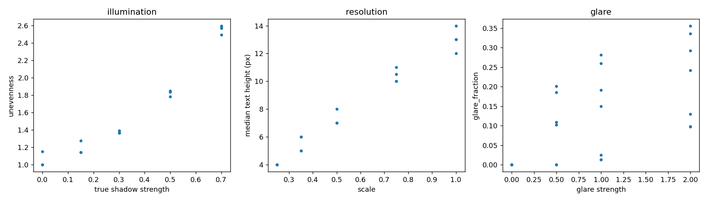

# Image-quality estimators: validation against ground truth

_Generated by `scripts/validate_quality.py`. Evaluation set: 364 images = 7 base pages x 52 recipes with known parameters (`data/quality_calib`; 3 of the pages are text-dense). Hint thresholds were fitted on a separate tuning set (156 images, different seed/pages) and are only *reported* on the evaluation set._

## A. Noise sigma estimation

Ground truth: the injected Gaussian sigma (Poisson recipes: the equivalent std on paper, sqrt(255*L/peak)). Subset = images whose only noise is additive Gaussian/Poisson (plus the clean and blur-only images, true sigma 0). Columns: Pearson / Spearman correlation of estimate vs truth, mean absolute error (gray levels), mean bias, and the OLS slope (1.0 = unbiased).

| Estimator - subset | n | Pearson | Spearman | MAE | bias | slope |
|---|---|---|---|---|---|---|
| legacy (whole-page MAD) - all pages | 175 | 0.989 | 0.992 | 0.92 | -0.79 | 0.89 |
| new: tile MAD - all pages | 175 | 1.000 | 0.996 | 0.10 | -0.07 | 0.99 |
| new: tile Immerkaer - all pages | 175 | 1.000 | 0.993 | 0.09 | -0.07 | 0.98 |
| legacy (whole-page MAD) - text-dense pages only | 75 | 0.985 | 0.988 | 0.80 | -0.48 | 0.93 |
| new: tile MAD - text-dense pages only | 75 | 1.000 | 0.996 | 0.07 | -0.03 | 1.00 |
| new: tile Immerkaer - text-dense pages only | 75 | 1.000 | 0.993 | 0.05 | -0.02 | 0.99 |
| legacy (whole-page MAD) - normal pages only | 100 | 0.995 | 0.999 | 1.01 | -1.01 | 0.86 |
| new: tile MAD - normal pages only | 100 | 1.000 | 0.996 | 0.12 | -0.11 | 0.98 |
| new: tile Immerkaer - normal pages only | 100 | 0.999 | 0.993 | 0.12 | -0.11 | 0.97 |

### Failure modes: images whose true Gaussian sigma is 0

Mean estimated sigma (and false-alarm rate = share of images with estimate > 2) per defect class. Ideal = 0.

| Defect | Pages | n | legacy mean est. | new mean est. | legacy false alarm | new false alarm |
|---|---|---|---|---|---|---|
| clean | normal | 4 | 0.00 | 0.00 | 0% | 0% |
| clean | dense | 3 | 0.00 | 0.00 | 0% | 0% |
| gaussian blur | normal | 20 | 0.00 | 0.00 | 0% | 0% |
| gaussian blur | dense | 15 | 0.00 | 0.00 | 0% | 0% |
| motion blur | normal | 16 | 0.00 | 0.00 | 0% | 0% |
| motion blur | dense | 12 | 0.00 | 0.00 | 0% | 0% |
| salt & pepper | normal | 16 | 0.00 | 0.00 | 0% | 0% |
| salt & pepper | dense | 12 | 0.00 | 0.00 | 0% | 0% |
| JPEG q<=50 | normal | 12 | 0.00 | 0.00 | 0% | 0% |
| JPEG q<=50 | dense | 9 | 1.32 | 0.00 | 33% | 0% |
| JPEG q>=75 | normal | 8 | 0.00 | 0.00 | 0% | 0% |
| JPEG q>=75 | dense | 6 | 0.49 | 0.00 | 17% | 0% |
| shadow | normal | 16 | 0.00 | 0.00 | 0% | 0% |
| shadow | dense | 12 | 0.00 | 0.00 | 0% | 0% |
| low resolution | normal | 16 | 0.00 | 0.00 | 0% | 0% |
| low resolution | dense | 12 | 0.00 | 4.29 | 0% | 42% |
| periodic | normal | 12 | 0.00 | 0.00 | 0% | 0% |
| periodic | dense | 9 | 0.00 | 0.00 | 0% | 0% |

Salt-and-pepper (true Gaussian sigma = 0): density vs estimates - the impulse fraction should track density.

| density | legacy sigma | new sigma | impulse fraction |
|---|---|---|---|
| 0.002 | 0.00 | 0.00 | 0.0017 |
| 0.005 | 0.00 | 0.00 | 0.0033 |
| 0.01 | 0.00 | 0.00 | 0.0057 |
| 0.03 | 0.00 | 0.00 | 0.0157 |

Dense text pages: flat-tile fraction used = 0.16 (normal pages 0.75); estimates flagged `relaxed` (too few flat tiles): 3% of dense images.

## B. Blur

Ground truth: injected Gaussian blur sigma. Direction: *higher legacy Laplacian variance = sharper*, *higher edge_width = blurrier*; Spearman is reported with the sign flipped for sharpness scores so that +1 always means 'perfectly monotone in the right direction'. New scores are computed on the image **after denoising** (NLM, as the pipeline does whenever sigma > 2).

No added noise; 6 blur levels (0, 0.5, 1, 1.5, 2, 3) per base page:

| Score | mean Spearman (right direction = +1) | pages strictly monotone over all 6 levels |
|---|---|---|
| legacy Laplacian variance (raw) | -1.000 | 7/7 |
| edge_width (denoised) | -0.998 | 6/7 |
| tenengrad_norm (denoised) | -1.000 | 7/7 |
| lap_var_edge (denoised) | -1.000 | 7/7 |
| edge_width (NOT denoised) | -0.998 | 6/7 |

**Content dependence.** Coefficient of variation (std/mean) of each score *across the 7 different pages* at the same true blur. A good sharpness measure should vary with blur, not with what is printed on the page:

| Score | blur 0.0 | blur 0.5 | blur 1.0 | blur 1.5 | blur 2.0 | blur 3.0 |
|---|---|---|---|---|---|---|
| legacy Laplacian variance (raw) | 0.91 | 0.87 | 0.76 | 0.66 | 0.59 | 0.69 |
| edge_width (denoised) | 0.03 | 0.06 | 0.10 | 0.10 | 0.13 | 0.01 |
| tenengrad_norm (denoised) | 0.14 | 0.13 | 0.12 | 0.08 | 0.08 | 0.09 |
| lap_var_edge (denoised) | 0.24 | 0.22 | 0.16 | 0.27 | 0.35 | 0.48 |
| edge_width (NOT denoised) | 0.03 | 0.06 | 0.10 | 0.10 | 0.13 | 0.01 |

**Noise inflation.** Score at noise sigma 16 divided by the same page & blur with no noise (1.00x = noise does not move the score; for the legacy sharpness score a value >1 means noise makes a blurry page look *sharper*):

| True blur | legacy Laplacian var (raw) | edge_width (denoised) | edge_width (NOT denoised) | tenengrad_norm (denoised) |
|---|---|---|---|---|
| blur 1.0 | 39.74x | 1.18x | 1.46x | 0.78x |
| blur 2.0 | 686.70x | 1.16x | 1.23x | 0.99x |
| blur 3.0 | 3732.60x | 0.85x | 0.81x | 1.32x |

Motion blur (length 3/5/9/15 px at a random angle, plus clean): Spearman(length, edge_width) = 0.801. Edge width is isotropic (it uses the gradient magnitude), so it detects motion blur but cannot tell its direction.

## C. Noise-type hints

Rule: periodic peak -> *periodic*; else impulse fraction -> *salt_pepper*; else JPEG blockiness -> *jpeg*; else sigma > 2 -> *gaussian*; else *none*. Thresholds below were fitted (max one-vs-rest F1) on the **tuning set** and are reported on the evaluation set.

| Hint | fitted threshold |
|---|---|
| periodic_peak | 5.177e+12 |
| impulse_fraction | 0.0023 |
| jpeg_blockiness | 1.186 |

**Evaluation set** - rows: true class, columns: predicted:

| true \ pred | none | gaussian | salt_pepper | jpeg | periodic | recall |
|---|---|---|---|---|---|---|
| none | 135 | 0 | 18 | 1 | 0 | 88% |
| gaussian | 6 | 119 | 8 | 0 | 0 | 89% |
| salt_pepper | 5 | 0 | 23 | 0 | 0 | 82% |
| jpeg | 24 | 0 | 4 | 0 | 0 | 0% |
| periodic | 3 | 0 | 0 | 0 | 18 | 86% |

Overall accuracy 81.0% (n=364).

Misclassified (true -> predicted: recipes; `*` = dense page):

* gaussian -> none: gauss_n2, gauss_n2* (6 images)
* gaussian -> salt_pepper: gauss_n2, gauss_n4, gauss_n6, gauss_n8, poisson1500, poisson600, gauss_n16*, poisson150* (8 images)
* jpeg -> none: jpeg75, jpeg50, jpeg30, jpeg15, jpeg75*, jpeg50*, jpeg30*, jpeg15* (24 images)
* jpeg -> salt_pepper: jpeg75, jpeg50, jpeg30, jpeg15 (4 images)
* none -> jpeg: lowres0.5 (1 images)
* none -> salt_pepper: clean, jpeg95, shadow0.15, shadow0.3, shadow0.5, shadow0.7, glare0.5, lowres0.5, lowres0.25, lowres0.5*, lowres0.35*, lowres0.25*, lowres0.75* (18 images)
* periodic -> none: periodic2*, periodic4*, periodic8* (3 images)
* salt_pepper -> none: sp0.002, sp0.002* (5 images)

**(for reference) tuning set - thresholds were fitted here** - rows: true class, columns: predicted:

| true \ pred | none | gaussian | salt_pepper | jpeg | periodic | recall |
|---|---|---|---|---|---|---|
| none | 50 | 0 | 3 | 13 | 0 | 76% |
| gaussian | 3 | 54 | 0 | 0 | 0 | 95% |
| salt_pepper | 2 | 0 | 10 | 0 | 0 | 83% |
| jpeg | 6 | 0 | 0 | 6 | 0 | 50% |
| periodic | 0 | 0 | 0 | 0 | 9 | 100% |

Overall accuracy 82.7% (n=156).

## D. Exposure and resolution estimators

* **Illumination unevenness** vs true shadow strength (0, 0.15, 0.3, 0.5, 0.7; 20 normal pages): Spearman 0.964; mean unevenness by strength: 0.0: 1.04, 0.15: 1.18, 0.3: 1.37, 0.5: 1.83, 0.7: 2.56.
  Expected for a linear ramp 1 -> (1-s): 1/(1-s) = 0.0: 1.00, 0.15: 1.18, 0.3: 1.43, 0.5: 2.00, 0.7: 3.33 (the estimator's percentile range shrinks this).
* On the *dense* pages unevenness for strength 0.7 = 2.59 vs 2.56 on normal pages; clean dense = 1.00 (text covers the paper so the background map is less reliable).
* **Glare** (a Gaussian hot spot, strength 0.5/1.0/2.0): strength 0: glare_fraction 0.0000, inside/outside edge ratio nan; strength 0.5: glare_fraction 0.0854, inside/outside edge ratio 0.48; strength 1.0: glare_fraction 0.1332, inside/outside edge ratio 0.19; strength 2.0: glare_fraction 0.2216, inside/outside edge ratio 0.09. Strength 0.5 does not reach saturation on this paper level, so no glare is expected there.
* **Text height** vs rendering scale (1, 0.75, 0.5, 0.35, 0.25; 20 normal pages): linear fit text_height = 12.0 x scale +1.2, R^2 = 0.977. Median text height by scale: 1.0: 13.0px, 0.75: 10.2px, 0.5: 7.0px, 0.35: 5.5px, 0.25: 4.0px.

