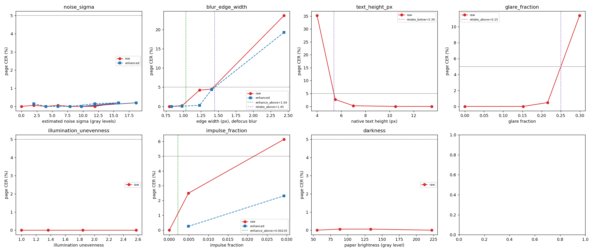

# Image quality vs OCR error, and the thresholds derived from it

_Generated by `scripts/quality_vs_cer.py`. 76 calibration images from 2 base pages (eval_bank_statement_v1, eval_invoice_v2), PaddleOCR on CPU. Page-level CER against the ground-truth page text. Clean-page CER = 0.0000. 'Unacceptable' = CER > 5%; enhancement 'helps' if it lowers CER by >= 1 percentage point._

Thresholds are read off the curves below (linear interpolation between recipe means); they are stored with their evidence in `docusight/quality_thresholds.json`. With few pages per point they are coarse: treat each as accurate to roughly one recipe step.

## noise_sigma

Thresholds: `enhance_above` = None, `enhance_stops_helping_above` = None, `retake_above` = None, `retake_raw_above` = None

| recipe | estimated noise sigma (gray levels) | CER raw | CER enhanced |
|---|---|---|---|
| clean | 0.000 | 0.0000 | - |
| gauss_n2 | 1.977 | 0.0006 | 0.0015 |
| gauss_n4 | 3.954 | 0.0000 | 0.0000 |
| gauss_n6 | 5.930 | 0.0006 | 0.0000 |
| gauss_n8 | 7.907 | 0.0000 | 0.0000 |
| gauss_n12 | 11.923 | 0.0000 | 0.0015 |
| gauss_n16 | 15.814 | 0.0020 | 0.0020 |
| poisson600 | 9.760 | 0.0000 | 0.0000 |
| poisson150 | 18.656 | 0.0020 | 0.0020 |

## blur_edge_width

Thresholds: `enhance_above` = 1.037, `enhance_stops_helping_above` = 1.365, `retake_above` = 1.448, `retake_raw_above` = 1.43

| recipe | edge width (px), defocus blur | CER raw | CER enhanced |
|---|---|---|---|
| clean | 0.798 | 0.0000 | - |
| gblur0.5 | 0.830 | 0.0000 | 0.0000 |
| gblur1.0 | 0.982 | 0.0020 | 0.0006 |
| gblur1.5 | 1.231 | 0.0424 | 0.0026 |
| gblur2.0 | 1.403 | 0.0450 | 0.0435 |
| gblur3.0 | 2.440 | 0.2364 | 0.1927 |

## text_height_px

Thresholds: `retake_below` = 5.394, `cer_at_lowest_tested` = 0.352

| recipe | native text height (px) | CER raw | CER enhanced |
|---|---|---|---|
| clean | 13.500 | 0.0000 | - |
| lowres0.75 | 10.500 | 0.0000 | - |
| lowres0.5 | 7.000 | 0.0026 | - |
| lowres0.35 | 5.500 | 0.0270 | - |
| lowres0.25 | 4.000 | 0.3520 | - |

## glare_fraction

Thresholds: `enhance_above` = None, `enhance_stops_helping_above` = None, `retake_above` = 0.2502, `retake_raw_above` = 0.2502

| recipe | glare fraction | CER raw | CER enhanced |
|---|---|---|---|
| clean | 0.000 | 0.0000 | - |
| glare0.5 | 0.152 | 0.0000 | - |
| glare1.0 | 0.216 | 0.0048 | - |
| glare2.0 | 0.299 | 0.1138 | - |

## illumination_unevenness

Thresholds: `enhance_above` = None, `enhance_stops_helping_above` = None, `retake_above` = None, `retake_raw_above` = None

| recipe | illumination unevenness | CER raw | CER enhanced |
|---|---|---|---|
| clean | 1.000 | 0.0000 | - |
| shadow0.3 | 1.366 | 0.0000 | - |
| shadow0.5 | 1.843 | 0.0000 | - |
| shadow0.7 | 2.574 | 0.0000 | - |

## impulse_fraction

Thresholds: `enhance_above` = 0.002188, `enhance_stops_helping_above` = None, `retake_above` = None, `retake_raw_above` = 0.02166

| recipe | impulse fraction | CER raw | CER enhanced |
|---|---|---|---|
| clean | 0.000 | 0.0000 | - |
| sp0.005 | 0.005 | 0.0250 | 0.0026 |
| sp0.03 | 0.029 | 0.0613 | 0.0232 |

## darkness

Thresholds: `retake_below` = None, `cer_at_lowest_tested` = 0

| recipe | paper brightness (gray level) | CER raw | CER enhanced |
|---|---|---|---|
| clean | 222.500 | 0.0000 | - |
| dark0.6 | 133.500 | 0.0006 | - |
| dark0.4 | 88.500 | 0.0006 | - |
| dark0.25 | 55.500 | 0.0000 | - |

## Motion blur: a documented miss of the edge-width estimator

Edge width is built from the gradient magnitude, which motion blur lowers only across the motion direction, so it under-reads: a 9 px motion blur (CER ~40%) scores an edge width of ~0.9 px, i.e. looks nearly sharp. The blur gate does **not** catch these pages.

| recipe | edge width (px) | CER raw | CER enhanced |
|---|---|---|---|
| motion3 | 0.851 | 0.0006 | 0.0000 |
| motion5 | 0.940 | 0.0320 | 0.0063 |
| motion9 | 0.914 | 0.4197 | 0.3844 |
| motion15 | 1.296 | 0.5265 | 0.5583 |

## Other defects (raw OCR only)

| recipe | mean CER | n |
|---|---|---|
| jpeg50 | 0.0062 | 2 |
| jpeg15 | 0.0069 | 2 |
| periodic4 | 0.0000 | 2 |
| dark0.6 | 0.0006 | 2 |
| dark0.4 | 0.0006 | 2 |
| dark0.25 | 0.0000 | 2 |

